<picture>
  <source media="(prefers-color-scheme: dark)" srcset="assets/profile-forge-dark.svg">
  
</picture>

<a href="https://www.linkedin.com/in/DA-SCRIVERE"><picture>
  <source media="(prefers-color-scheme: dark)" srcset="assets/buttons/linkedin-dark.svg">
  
</picture></a>

<!--
  The card above is generated by .github/workflows/profile-forge.yml from config.json.
  Edit config.json (about, workingOn, links, theme, layout...) and run the workflow from the Actions tab.
-->
